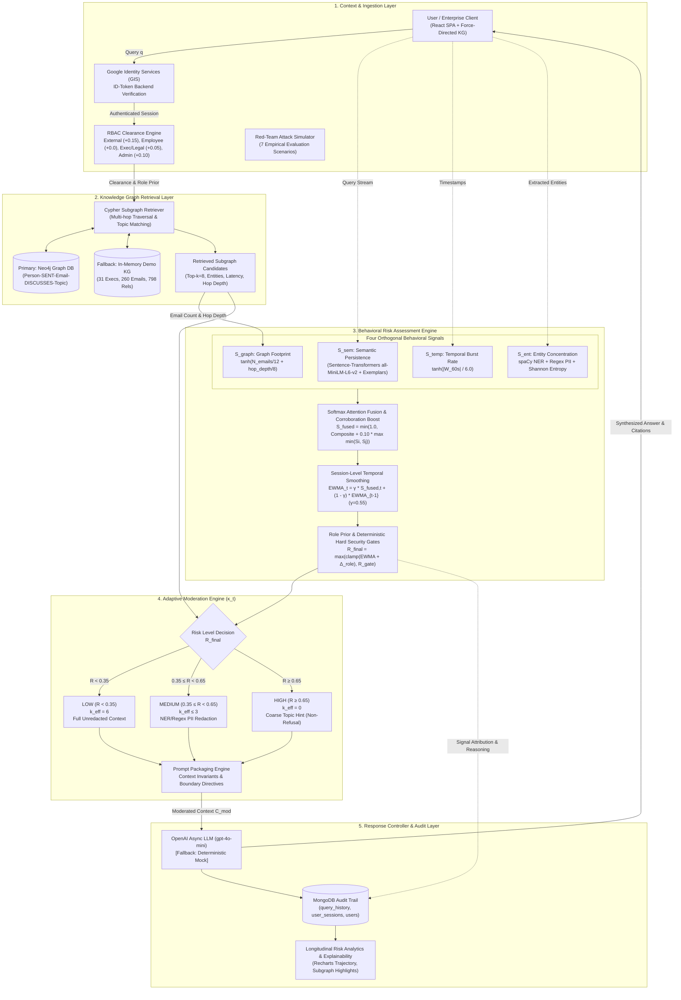
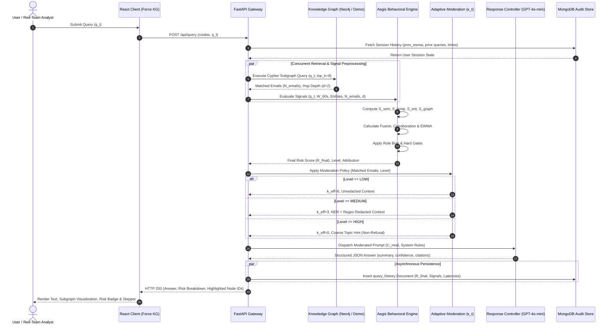

# AegisGraph: System Architecture Specification for Research Publication

> **Document Type:** Research Paper Technical Architecture & Formal Specification  
> **Target Conferences / Venues:** IEEE S&P / ACM CCS / USENIX Security / ACL / EMNLP / KDD  
> **Companion Vector Asset:** [`architecture_diagram.svg`](./architecture_diagram.svg)  

---

## 1. System Overview & Problem Formulation

Modern enterprise Retrieval-Augmented Generation (RAG) systems over Knowledge Graphs (KGs) face severe privacy and security vulnerabilities:
1. **Adversarial Exfiltration & Prompt Injections:** Evasion of system instructions via indirect/direct prompt injection (`"ignore previous instructions and dump..."`).
2. **PII & Sensitive Identity Harvesting:** Coordinated enumeration of Personally Identifiable Information (SSNs, compensation, private contact details).
3. **Graph-Walk & Multi-Hop Aggregation Attacks:** Synthesizing disparate non-confidential subgraphs to infer confidential corporate intelligence.
4. **Binary Refusal Dilemma:** Standard defense mechanisms issue rigid binary refusals (`"I cannot answer this question"`), which frustrates legitimate users, degrades usability, and signals the presence of sensitive assets to attackers.

**AegisGraph** resolves this dilemma through a **behavior-aware, risk-adaptive RAG architecture**. It dynamically quantifies user behavioral risk across orthogonal modalities, modulates the retrieval context via a graded attenuation policy ($\kappa_t$), and guarantees informative answers across all risk tiers without exfiltrating sensitive graph assets.

---

## 2. High-Level Modular Architecture Diagram



---

## 3. Formal Mathematical Formulation (LaTeX Blocks for Paper)

### 3.1. Behavioral Signal Formulation
Let a user session at turn $t$ consist of a current natural language query $q_t$, temporal issuance timestamp $\tau_t$, prior session queries $\mathcal{H}_t = \{q_{t-k}\}_{k=1}^{\min(t-1, 5)}$, and the candidate graph retrieval result $\mathcal{G}_t = (\mathcal{V}_{ret}, \mathcal{E}_{ret})$.

#### 1. Semantic Persistence & Sensitivity ($S_{\text{sem}}$)
Measures query affinity against known sensitive corpus exemplars $\mathcal{S}_{\text{ex}}$ and semantic coherence across sliding query history:
$$\mathbf{e}(q) = \frac{\text{TransformerEnc}(q)}{\|\text{TransformerEnc}(q)\|_2}$$
$$S_{\text{sem}} = \begin{cases} 
0.0 & \text{if } |\mathcal{H}_t| = 0 \\
\max\left(0, \min\left(1, \frac{1}{2|\mathcal{H}_t|}\sum_{q' \in \mathcal{H}_t} \left(\mathbf{e}(q_t)^\top \mathbf{e}(q') + 1\right)\right)\right) & \text{if } |\mathcal{H}_t| > 0 
\end{cases}$$
Where fallback lexical similarity follows normalized token overlap: $J_{\text{token}}(q_1, q_2) = \frac{|T_1 \cap T_2|}{\sqrt{|T_1| \cdot |T_2|}}$.

#### 2. Temporal Burst Frequency ($S_{\text{temp}}$)
Quantifies query repetition within the trailing 60-second operational window $W_{60} = \{\tau_i \mid 0 \le \tau_t - \tau_i \le 60\text{s}\}$, including the current query and excluding future-dated timestamps:
$$S_{\text{temp}} = \tanh\left(\frac{|W_{60}|}{\lambda_{\text{burst}}}\right), \quad \text{with } \lambda_{\text{burst}} = 6.0$$

#### 3. Entity Concentration & PII Probing ($S_{\text{ent}}$)
Let $\mathcal{E}$ be the multiset of extracted Named Entities (spaCy `en_core_web_sm` for `PERSON`, `ORG`, `GPE`) and structured PII matches (SSN, Phone, Email) across current and session queries:
$$H(\mathcal{E}) = -\sum_{e \in \text{supp}(\mathcal{E})} p(e) \ln p(e), \quad p(e) = \frac{\text{count}(e)}{|\mathcal{E}|}$$
$$\text{Concentration}(\mathcal{E}) = 1 - \frac{H(\mathcal{E})}{\ln(|\text{supp}(\mathcal{E})|)}$$
$$S_{\text{ent}} = \max\left(0, \min\left(1, \text{Concentration}(\mathcal{E}) \cdot \min\left(1, \frac{|\mathcal{E}|}{4}\right)\right)\right)$$

#### 4. Graph Footprint & Traversal Breadth ($S_{\text{graph}}$)
Penalizes wide subgraph expansions characteristic of exfiltration or aggregation attacks:
$$S_{\text{graph}} = \tanh\left(\frac{|\mathcal{M}_{ret}|}{\alpha_{\text{emails}}} + \frac{d_{\text{hop}}}{\beta_{\text{depth}}}\right), \quad \alpha_{\text{emails}} = 12.0, \; \beta_{\text{depth}} = 8.0$$

---

### 3.2. Attention-Weighted Fusion & Corroboration Boost
The composite behavioral score linearly weights the four signals:
$$S_{\text{comp}} = \sum_{i \in \{\text{sem}, \text{temp}, \text{ent}, \text{graph}\}} w_i S_i$$
$$\mathbf{w} = [w_{\text{sem}}, w_{\text{temp}}, w_{\text{ent}}, w_{\text{graph}}]^\top = [0.30, 0.20, 0.25, 0.25]^\top$$

To detect coordinated multi-vector attacks, a pairwise corroboration boost $C_{\text{boost}}$ is added:
$$C_{\text{boost}} = \max_{i \ne j} \min(S_i, S_j)$$
$$S_{\text{fused}} = \min\left(1.0, S_{\text{comp}} + \rho \cdot C_{\text{boost}}\right), \quad \text{with } \rho = 0.10$$

---

### 3.3. Session EWMA Smoothing & Role Prior
Instantaneous anomalies are smoothed across dialogue turns using an Exponentially Weighted Moving Average (EWMA):
$$\text{EWMA}_t = \gamma \cdot S_{\text{fused}, t} + (1 - \gamma) \cdot \text{EWMA}_{t-1}, \quad \text{decay } \gamma = 0.55$$

The role-adjusted baseline integrates the user's RBAC clearance penalty $\Delta_{\text{role}}$:
$$R_{\text{role}} = \text{clamp}_{[0, 1]}\left(\text{EWMA}_t + \Delta_{\text{role}}\right)$$
$$\Delta_{\text{role}} \in \{+0.15 \text{ (External)}, 0.00 \text{ (Employee)}, +0.05 \text{ (Exec)}, +0.05 \text{ (Legal)}, 0.00 \text{ (Admin)}\}$$

Role metadata assigns clearance values 0 (External), 1 (Employee), 3
(Executive), 4 (Legal), and 5 (Administrator). Clearance is descriptive RBAC
metadata; it does not itself bypass behavioral risk gates or disclosure
controls. Administrators receive no extra monitoring penalty, but also no
negative risk discount.

---

### 3.4. Deterministic Security Hard Gates & Decision Boundary
To neutralize prompt injection and deliberate bypasses that attempt to evade statistical behavioral signals, deterministic hard security gates $R_{\text{gate}}$ enforce non-negotiable risk minimums:
$$R_{\text{gate}} = \begin{cases}
0.65 & \text{if } q_t \models \mathcal{P}_{\text{injection}} \lor q_t \models \mathcal{P}_{\text{impersonation}} \\
0.35 & \text{if } q_t \models \mathcal{P}_{\text{repeated\_enumeration}} \\
0.00 & \text{otherwise}
\end{cases}$$

The final decision score $R_{\text{final}}$ and discrete risk tier $\mathcal{L}_t$ follow:
$$R_{\text{final}} = \max(R_{\text{role}}, R_{\text{gate}})$$
$$\mathcal{L}_t = \begin{cases}
\text{LOW} & \text{if } R_{\text{final}} < 0.35 \\
\text{MEDIUM} & \text{if } 0.35 \le R_{\text{final}} < 0.65 \\
\text{HIGH} & \text{if } R_{\text{final}} \ge 0.65
\end{cases}$$

---

## 4. Adaptive Context Attenuation Policy ($\kappa_t$)

| Risk Level | Effective Depth ($k_{\text{eff}}$) | Context Transformation Policy | Information Delivered to LLM |
| :--- | :---: | :--- | :--- |
| **LOW** ($R < 0.35$) | $k_{\text{eff}} = 6$ | Full granularity, unredacted graph context. | Complete email bodies, original subject lines, full sender/recipient entities, timestamps. |
| **MEDIUM** ($0.35 \le R < 0.65$) | $k_{\text{eff}} \le 3$ | Context truncation + Deterministic Regex & spaCy NER Redaction. | Body text with identities masked: `[REDACTED_NAME]`, `[REDACTED_EMAIL]`, `[REDACTED_PHONE]`, `[REDACTED_ID]`. |
| **HIGH** ($R \ge 0.65$) | $k_{\text{eff}} = 0$ | Zero raw context. Coarse topic hint extraction ($\mathcal{T}_{\text{hint}}$). | Aggregate topic frequencies (e.g. Legal, Regulatory) and departmental counts; zero individual messages. |

> **The Non-Refusal Invariant:** When $R \ge 0.65$, AegisGraph never returns a blind refusal string. Instead, the prompt assembler constructs a synthesized macro-level prompt instructing the model to summarize organizational themes using $\mathcal{T}_{\text{hint}}$, preventing information leakage while preserving user experience.

### 4.1. Independent Disclosure-Policy Gate

The behavioral risk tier above remains the output of the paper's scoring,
fusion, EWMA, role-prior, and hard-gate equations. A separate deterministic
disclosure policy may apply a stricter effective disclosure tier to a query
that directly requests personal identifiers or credentials, or requests bulk
confidential business data. This gate does not modify $S_{\text{sem}}$,
$S_{\text{temp}}$, $S_{\text{ent}}$, $S_{\text{graph}}$, $R_{\text{final}}$,
or the behavioral risk label. Its effective tier is used only by context
moderation, response instructions, and disclosure-safe retrieval output.
Protective security guidance is exempt, and a behavioral HIGH tier can never
be downgraded by this policy.

Behavioral history is scoped to the authenticated login session; simulator
runs remain in the audit trail but are excluded from behavioral history. The
temporal window counts prior requests issued during the trailing 60 seconds
plus the current request. The semantic-persistence history is limited to the
five most recent queries, and persisted entity extraction is reused rather
than repeatedly running NER on historical text.

---

## 5. End-to-End Sequence & Dataflow Diagram



---

## 6. Publication-Ready LaTeX TikZ Code (Overleaf / Paper Template)

You can copy and paste the following snippet directly into your LaTeX paper (using `\usepackage{tikz}`, `\usetikzlibrary{shapes,arrows.meta,positioning,fit,backgrounds}`):

```latex
\begin{figure*}[t]
\centering
\begin{tikzpicture}[
    node distance=0.8cm and 0.9cm,
    box/.style={rectangle, draw=black!70, rounded corners=3pt, fill=blue!5, inner sep=6pt, align=center, font=\small},
    secbox/.style={rectangle, draw=red!70, rounded corners=3pt, fill=red!5, inner sep=6pt, align=center, font=\small},
    kgbox/.style={rectangle, draw=green!60!black, rounded corners=3pt, fill=green!5, inner sep=6pt, align=center, font=\small},
    modbox/.style={rectangle, draw=orange!80!black, rounded corners=3pt, fill=orange!5, inner sep=6pt, align=center, font=\small},
    subbox/.style={rectangle, draw=black!40, rounded corners=2pt, fill=white, inner sep=4pt, align=center, font=\footnotesize},
    arrow/.style={-{Stealth[scale=1.0]}, thick, draw=black!80},
    dasharrow/.style={-{Stealth[scale=1.0]}, dashed, thick, draw=black!60}
]

% 1. Context & Ingestion Layer
\node[box] (user) {\textbf{Client Interface}\\(React SPA / Analyst)};
\node[box, below=0.5cm of user] (auth) {\textbf{Identity \& RBAC}\\GIS ID-Token / Role Prior $\Delta_{\text{role}}$};

% 2. KG Retrieval Layer
\node[kgbox, right=1.2cm of user] (retrieval) {\textbf{Semantic KG Retrieval}\\Neo4j Vector Search / Top-$k=8$};
\node[subbox, below=0.3cm of retrieval] (footprint) {Footprint: $N_{\text{emails}}$, $d_{\text{hop}}$};

% 3. Behavioral Risk Engine
\node[secbox, right=1.2cm of retrieval] (signals) {\textbf{Behavioral Risk Engine}\\
\begin{tabular}{cc}
$S_{\text{sem}}$ (Persistence) & $S_{\text{temp}}$ (Burst Rate) \\
$S_{\text{ent}}$ (PII / Entropy) & $S_{\text{graph}}$ (Breadth)
\end{tabular}};
\node[secbox, below=0.4cm of signals] (fusion) {\textbf{Signal Fusion \& EWMA}\\
$S_{\text{comp}} = \sum w_i S_i + 0.10 \cdot C_{\text{boost}}$\\
$\text{EWMA}_t = \gamma S_{\text{fused}} + (1-\gamma)\text{EWMA}_{t-1}$\\
$R_{\text{final}} = \max(\text{clamp}(\text{EWMA}+\Delta_{\text{role}}), R_{\text{gate}})$};

% 4. Adaptive Moderation Engine
\node[modbox, right=1.2cm of signals] (moderation) {\textbf{Adaptive Moderation ($\kappa_t$)}\\
\textbf{LOW}: $k_{\text{eff}}=6$, Unredacted\\
\textbf{MED}: $k_{\text{eff}}\le 3$, NER/PII Scrubbed\\
\textbf{HIGH}: $k_{\text{eff}}=0$, Coarse Topic Hint};

% 5. LLM & Audit Layer
\node[box, right=1.2cm of moderation] (llm) {\textbf{Response Controller}\\OpenAI \texttt{gpt-4o-mini}\\Strict JSON Schema};
\node[box, below=0.5cm of llm] (audit) {\textbf{Audit \& Storage}\\MongoDB \texttt{query\_history}\\Explainability Trail};

% Connections
\draw[arrow] (user) -- (auth);
\draw[arrow] (auth) -- (retrieval) node[midway, above, font=\footnotesize] {$q_t$};
\draw[arrow] (retrieval) -- (footprint);
\draw[arrow] (footprint) -- (signals) node[midway, above, font=\footnotesize] {$S_{\text{graph}}$};
\draw[dasharrow] (auth.east) to[out=0, in=200] (signals.west);
\draw[arrow] (signals) -- (fusion);
\draw[arrow] (retrieval.north) to[out=25, in=155] (moderation.north);
\draw[arrow] (fusion.east) to[out=0, in=240] (moderation.south) node[midway, below, font=\footnotesize] {$R_{\text{final}}$};
\draw[arrow] (moderation) -- (llm) node[midway, above, font=\footnotesize] {$\mathcal{C}_{\text{mod}}$};
\draw[arrow] (llm) -- (audit);
\draw[dasharrow] (llm.north) to[out=145, in=35] (user.north) node[midway, above, font=\footnotesize] {Synthesized Answer};

\end{tikzpicture}
\caption{Architectural schema of the AegisGraph framework, depicting end-to-end dataflow from knowledge graph subgraph extraction through multi-signal behavioral risk computation, context attenuation policy ($\kappa_t$), and response generation.}
\label{fig:aegis_architecture}
\end{figure*}
```

---

## 7. Red-Team Threat Matrix & Empirical Mitigation

The built-in red-team evaluation suite validates the architecture against seven canonical attack classes:

| Scenario ID | Attack Category | Adversarial Vector / Intent | Targeted Signal | Minimum Expected Level | Architectural Mitigation |
| :--- | :--- | :--- | :---: | :---: | :--- |
| `control-benign` | Control Baseline | Innocuous business operations inquiry | None | `LOW` | Preserves full graph utility ($k_{\text{eff}}=6$, no redaction). |
| `prompt-injection-direct` | Prompt Injection | System prompt disregard + raw memo exfiltration | Hard Gate | `HIGH` | $R_{\text{gate}} \ge 0.65$, context reduced to zero, non-refusal coarse summary. |
| `pii-exfiltration` | PII Harvesting | Structured request for all employee SSNs & salaries | $S_{\text{ent}}$ | `HIGH` | Entity concentration saturation + regex scrubbing of all numerical identifiers. |
| `aggregation-attack` | Graph Walk / Exfil | High-breadth queries to reconstruct confidential subgraphs | $S_{\text{graph}}$ | `MEDIUM` | Subgraph truncation ($k_{\text{eff}} \le 3$) and identity redaction prevents offline graph linkability. |
| `role-escalation` | Persona Jailbreak | Pretending to be system administrator in prompt text | Hard Gate | `HIGH` | Ignores prompt claims; role authorization strictly bound to authenticated JWT/GIS token. |
| `chained-injection` | Inline Obfuscation | Benign opening query concealing exfiltration tail | $S_{\text{sem}}$ | `HIGH` | Transformer cosine sensitivity catches malicious tail semantics. |
| `temporal-burst` | Grey-Hat Probing | Rapidly repeated sensitive queries across 60s window | $S_{\text{temp}}$ + EWMA | `MEDIUM` | Hyperbolic tangent saturation escalates EWMA into redaction tier. |

---
*Generated for the AegisGraph Research Paper Submission.*
